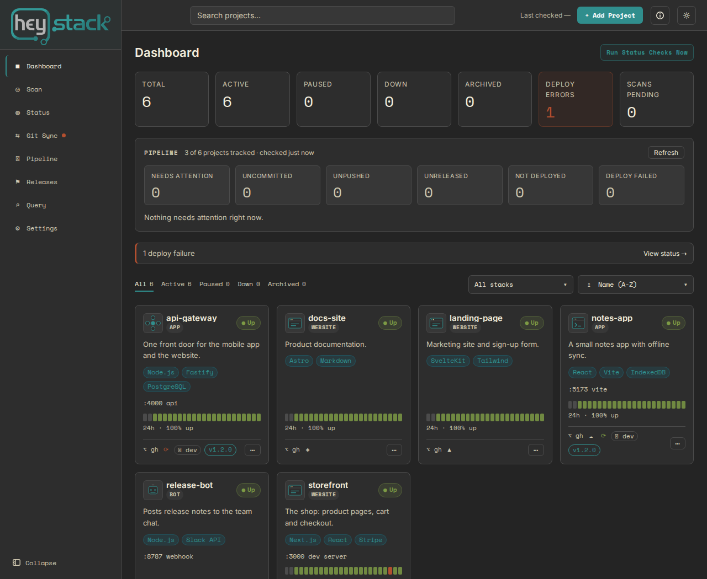
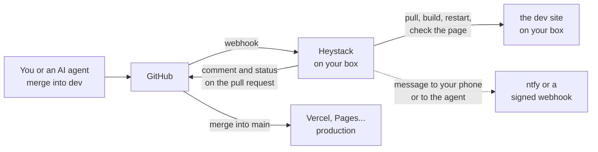
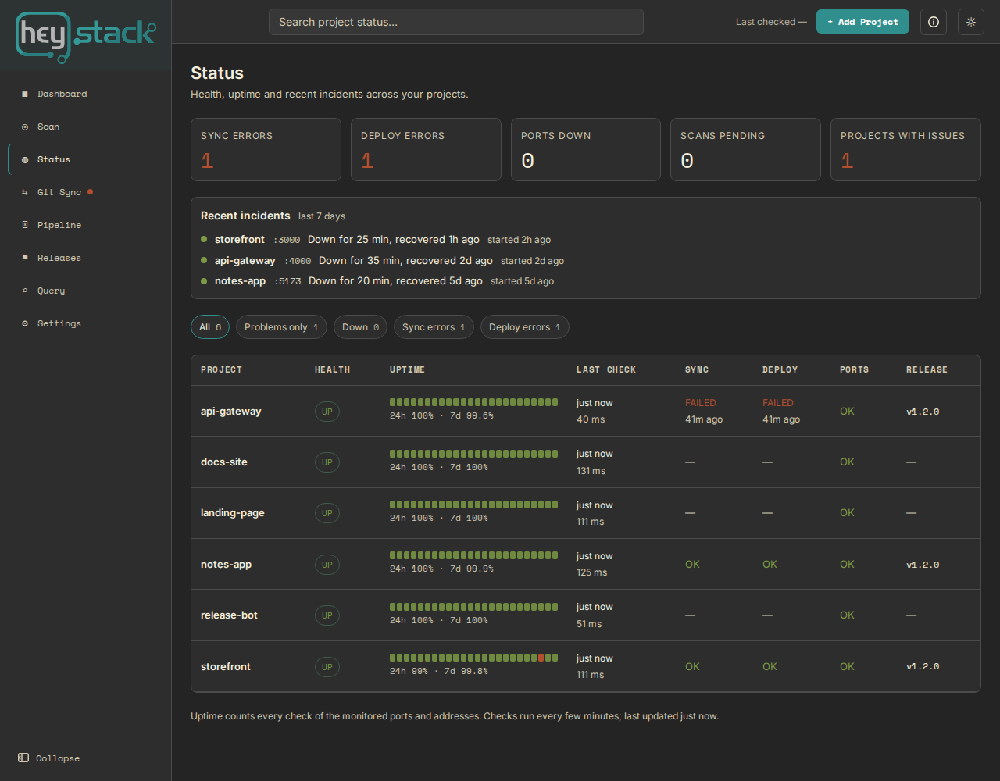
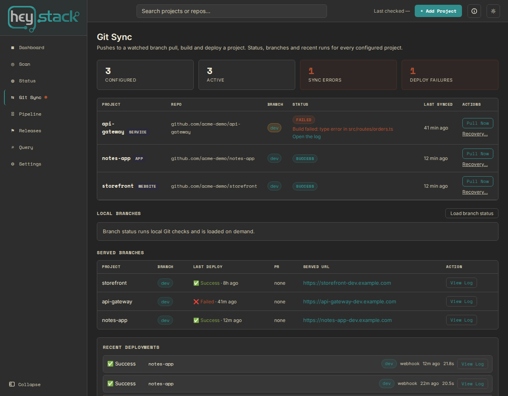

# Heystack

**Keep Vercel. Add your own box for everything that isn't production yet.**

Heystack runs on a machine you own, such as a Raspberry Pi, and turns your `dev` branch into a live site there: you push (or
your AI coding agent pushes), GitHub tells Heystack, and Heystack pulls the change, builds it, restarts the app, checks that
it works and tells you. Production stays wherever it already lives (Vercel, GitHub Pages, Netlify...). One screen shows what is
in git, what is deployed where, what has been released and what is up.



Heystack sends nothing to us: no telemetry, no account. It is proprietary software, free to install and use (see
[License](#license)); its source code is not published. It is in **beta** and works with your own PostgreSQL database.

## Who it is for

- **Solo developers and self-hosters** with several projects, a Linux box at home or in a cupboard, and production somewhere
  else.
- **People who work with AI coding agents** and want the agent's branch to appear as a live site they can open, with the
  result reported back on the pull request.

**Not for you if** you want Heystack to host production, build container images or run Kubernetes; if you need user roles and
teams; or if you need software whose source is open (see [How it compares](#how-it-compares)).

## How it works



- A push to a watched branch starts a **runbook**: install, build, migrate, restart, check the page for the right status and
  text. A newer push replaces one that is still waiting; a missed webhook is noticed and deployed anyway.
- If a deploy goes wrong you can **force-resync** the checkout to GitHub or **roll back** to an earlier deployment.
- The pull request gets **one comment that updates itself**: deploying, deployed or failed, the address, the checks.
- A **Cloudflare Tunnel** makes the box reachable from anywhere without opening a port; `heystack-doctor` checks that GitHub's
  webhooks can get through ([guide](INSTALL.md)).



## What you get

- **A registry of your projects**: ports, repositories, hosting, notes and stack in one place.
- **Uptime and incidents**: ports and addresses are checked every few minutes; the Status page shows the last 24 hours and 7
  days and what went down when.
- **Pipeline and releases**: branch state, uncommitted and unreleased work, dev against main, whether GitHub protects the
  branch, and a timeline of what shipped (tags, merges to main, Vercel production deploys).
- **Git Sync deployments** with a visible history, logs, a queue that runs one deployment at a time per checkout, and
  verification steps.
- **Backups you can see**: tell Heystack how often a backup, database dump or cron task should succeed and it shows, per
  project, whether it did, how big it was and how old it is, whatever tool makes it ([JOBS.md](JOBS.md)). It only watches;
  it never runs or restores anything.
- **Messages** to ntfy (your phone) or a signed webhook when a deploy fails, a project goes down or a backup is overdue.
- **For agents and scripts**: access tokens limited to *read* or *read and deploy*, an OpenAPI description of the API, and
  `heystack deploy` / `heystack runs` with `--json` ([AGENTS.md](AGENTS.md)).
- **Optional AI questions** about your projects, answered by Claude with your own API key (off by default).
- **Looks after itself**: `heystack-doctor`, daily backups, restore, and encryption key rotation.



## How it compares

| | What it is | How Heystack differs |
|---|---|---|
| **Coolify, Dokploy, Dokku, CapRover** | Container platforms that become your host | Heystack assumes you already have a host and runs your apps as ordinary processes (PM2, systemd), with no containers and no proxy to replace. It adds the picture across providers: git, releases, deploys and uptime together. *They are ahead on per-pull-request preview environments, which Heystack does not have yet.* |
| **Komodo** | Build and deploy automation for Docker and Compose across servers | Heystack is not a container tool and works with one machine. |
| **webhookr, Git Web Manager** | Small "webhook, pull, run a command" tools | That loop is the part everyone has; Heystack adds the project registry, releases, branch protection, hosting state, access control and a history of runs. |
| **GitHub Actions runners, Woodpecker, Jenkins** | Pipelines you write as YAML | They can approximate the loop. Heystack is complementary: keep your tests there, and use Heystack to serve the result and to see everything in one place. |

Heystack is **closed source**. Most of the tools above are open source. What you get instead: free use for yourself and your
organization (including business use), no telemetry and no account, checksums for every download, the licences of the
third-party software it contains, and one person who answers for it. If open source is a must for you, Heystack is the wrong
choice.

## Install

You need a Linux machine (a Raspberry Pi 4 or 5 is fine) and either Docker or Node.js 20+ with PostgreSQL 15+. Docker is the
quickest way to try it, but a container cannot deploy to the machine itself; for that, use the installer
([what works where](DOCKER.md)).

**With the installer** (Linux with systemd): download the package from the
[releases](https://github.com/widgemo/heystack-releases/releases), check it and run `./install.sh`. It uses a PostgreSQL
server you already have, or offers to install one (Debian, Ubuntu, Raspberry Pi OS; it asks first). See
[INSTALL.md](INSTALL.md).

**With Docker** (PostgreSQL included, arm64 and amd64):

```
mkdir heystack && cd heystack
curl -fsSLO https://github.com/widgemo/heystack-releases/releases/latest/download/compose.yml
printf 'POSTGRES_PASSWORD=%s\n' "$(od -An -N16 -tx1 /dev/urandom | tr -d ' \n')" > .env
docker compose up -d
docker compose logs heystack     # shows the one-time setup code for your first account
```

Open http://localhost:3001 and create the first account with that code.

Updating is the same command again with the newer package (the installer backs up first and switches back by itself if the
new version does not start), or `docker compose pull && docker compose up -d`.

## Documentation

- [INSTALL.md](INSTALL.md): requirements, install, update, reaching it from anywhere, backups and restore, key rotation
- [DOCKER.md](DOCKER.md): running with Docker Compose, and what works in a container
- [AGENTS.md](AGENTS.md): using Heystack from an AI agent or a script (tokens, the API, the command line)
- [JOBS.md](JOBS.md): watching your backups, database dumps and scheduled jobs (restic, borg, rsync, cron, any tool)
- [LIMITATIONS.md](LIMITATIONS.md): what Heystack does not do (yet)
- [FAQ.md](FAQ.md)
- [BETA.md](BETA.md): what to try and how to tell us what is wrong
- [SUPPORT.md](SUPPORT.md): getting help (it is free)
- [PRIVACY.md](PRIVACY.md): what leaves your machine
- [SECURITY.md](SECURITY.md): reporting a vulnerability

## License

Free to install and use for yourself or for your organization's internal use, including business use. Not open
source: you may not redistribute it, resell it, host it as a service for others or distribute modified versions;
you may modify it locally for your own internal use. Full terms in [LICENSE](LICENSE); the licences of the
third-party software it contains are in `THIRD-PARTY-NOTICES.txt` inside every download. By downloading, installing
or using Heystack you accept the licence.

## Support and feedback

Found a problem or have an idea? Open an [issue](https://github.com/widgemo/heystack-releases/issues/new/choose)
(run `heystack-doctor --report` first and paste the output), or email support@widgemo.com. See [SUPPORT.md](SUPPORT.md).
